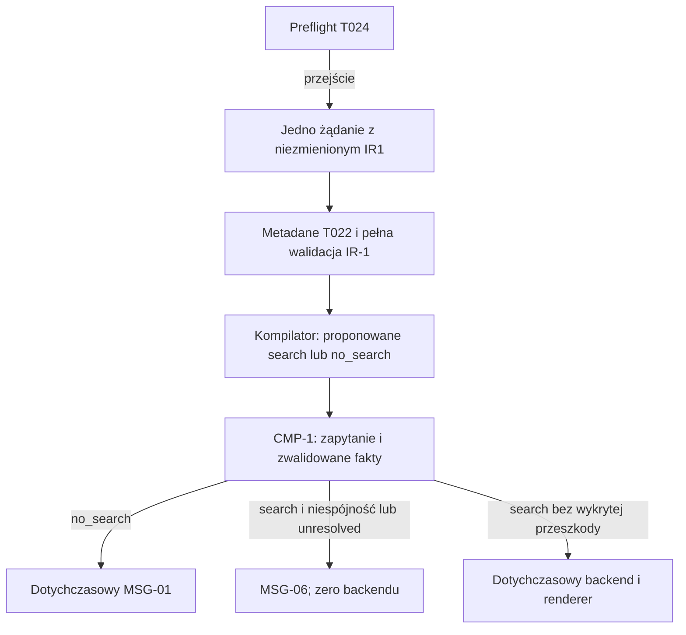

# CMP-1 — ograniczona kontrola kompletności interpretacji

Data: 2026-11-18. **Projekt T028, niewdrożony (DEC-17).**
Podstawa: [T027](../../docs/reports/t027_interpretation_2026-11-18.md),
[IR-1](interpretation-contract.md), [zadania](tasks.md),
[weryfikacja projektu](verification.md#t028--projekt-cmp-1-zakończony).

## 1. Problem i decyzja

T027 miało poprawny format IR w 36/36 prób, lecz dokładne fakty w 19/36.
Model pomijał kategorie i cel, zastępował wymagane mięso przez cofnięcie
wykluczenia oraz bezmleczność przez laktozę. Kompilator wykonywał reguły
dla otrzymanych faktów; brakująca kategoria uruchamiała default kolacja.
W trzech próbach pominięta kolacja przypadkiem dawała poprawny wynik końcowy.

**Wybrano CMP-1: lokalny, ograniczony kontroler spójności rozpoznanych
sygnałów z faktami, blokujący niespójny zamiar wyszukania.** Pozostają lista
faktów, wire IR-1, prompt IR1, model i kompilator. Kontroler nie dopisuje,
nie usuwa i nie poprawia faktów ani parametrów. To zabezpieczenie przed
częścią błędnych dispatch, nie rozwiązanie całej ekstrakcji lub kwalifikacja MVP.
Implementacja będzie osobnym T029, bez nowych płatnych wywołań.

| Wariant | Korzyść | Ograniczenie / decyzja |
| --- | --- | --- |
| Lista IR-1 i dalsze instrukcje o kompletności | Najmniejsza zmiana transportu. | Sam nakaz już istnieje; brak mechanicznej kontroli pominięcia. Nie wybrano kolejnej zmiany promptu w T028. |
| Wymagane grupy category/goal/protein/... ze stanem present/absent/uncertain | Każda grupa ma jawny wynik, łatwiejszy audyt. | Model może błędnie wpisać absent lub pustą listę. Wymaga migracji schematu i nowego pomiaru; nie gwarantuje semantyki. Nie wybrano teraz. |
| Lokalne rozpoznawanie i dopisywanie brakujących faktów | Może poprawić wynik aplikacji dla znanych fraz. | Zmienia źródło interpretacji, zasady rozstrzygania konfliktów i pomiar jakości. Nie wybrano automatycznej naprawy. |
| Ograniczona kontrola przed dispatch | Zachowuje transport i reguły; można sprawdzić deterministycznie na zapisanych odpowiedziach. | Wymaga jawnej gramatyki i testów fałszywych blokad. Nie wykrywa wymagań poza jej zakresem. **Wybrano.** |
| Drugi model lub automatyczne ponowienie | Niezależna próba interpretacji. | Dodatkowy koszt i nowy kontrakt; poza wybranym zakresem. |

## 2. Co oznacza brak

| Sytuacja | Co wiemy i jak postąpić |
| --- | --- |
| Użytkownik nie wskazał wymagania | To etykieta semantyczna w ocenie. W runtime sam brak faktu lub lokalnego dopasowania nie dowodzi takiej sytuacji. Dla poprawnej, zgodnej interpretacji nadal działają dotychczasowe defaulty. |
| Użytkownik jawnie cofnął wymaganie | Fakt waived z właściwym operatorem i źródłem. Nie zamieniać tego na zakaz ani required. |
| Model pominął wymaganie | Stwierdzane w eval względem gold; CMP wykryje tylko podzbiór, dla którego ma jednoznaczny lokalny sygnał i nie znajduje odpowiadającego faktu. |
| Model błędnie oznaczył wymaganie | Np. lokalne z mięsem wymaga protein/meat/required, a model podał exclusion/meat/waived. Dosłowny source nie wystarcza do potwierdzenia znaczenia. |
| Nie rozstrzygnięto operatora lub zakresu znanego sygnału | unresolved. Nie wybierać pierwszego wariantu ani nie zastępować problemu defaultem. Przy zamiarze search zatrzymać wykonanie. |
| Nie ma sygnału objętego kontrolą | no_supported_cues, a nie confirmed_absent lub complete. CMP nie dostarcza wtedy nowego dowodu semantycznego. |

Nie dodajemy do modelowego IR stanu absent. Nowa wersja dotyczy lokalnej
polityki CMP-1, nie schematu JSON. Wymuszone grupy pozostają alternatywą
do ewentualnego osobnego projektu, jeśli wynik T029 uzasadni migrację.

## 3. Przepływ i kontrakt lokalny

Preflight nadal może zakończyć zapytanie przed modelem. Kompilator jest
czysty i nie wykonuje lookup, więc jego wynik przed kontrolą jest tylko
propozycją. CMP nie zmienia biznesowego no_search w błąd; może dodatkowo
opisać luki diagnostycznie, lecz blokada dotyczy wyłącznie search.
Błędna odmowa modelu nadal pozostaje porażką decyzji; CMP jej nie naprawia.

Planowana czysta funkcja przyjmuje bieżący tekst, niezmienny zwalidowany
Interpretation i Compilation. Nie przyjmuje gold, klienta SDK ani katalogu.
Zwraca wynik o następującym znaczeniu:

| Pole | Kontrakt |
| --- | --- |
| policy_version | CMP-1 |
| status | not_applicable, no_supported_cues, consistent, inconsistent albo unresolved |
| checked_rules | ID faktycznie sprawdzonych reguł; bez twierdzenia o całej semantyce |
| findings | Lokalny rule_id, dokładny fragment bieżącego tekstu, oczekiwany kind/value/status i missing_fact lub unresolved_scope |
| block_search | true tylko dla proponowanego search i inconsistent/unresolved |

Obecność sygnatury kind/value/status spełnia kontrolowane wymaganie.
Nie wymagamy identycznych granic source względem adnotacji; każdy source
musi wcześniej przejść IR-1. Fakty i sygnały deduplikujemy dopiero po
walidacji. Obecność poprawnej sygnatury nie dowodzi, że wszystkie dodatkowe
fakty są poprawne — tę granicę zachowujemy w scenariuszach ograniczeń.

## 4. Zamknięty zakres reguł do T029

Rozpoznawanie dotyczy samodzielnej prośby recipe. Nie używać podciągów,
ogólnego dopasowania prefiksów ani całego zdania po słowie nie.
Pracować na granicach słów; dopuszczać różną wielkość liter, brak polskich
znaków, Unicode NFC/NFD i wielokrotne odstępy. Normalizacja służy tylko
rozpoznaniu. Źródła w IR pozostają dosłowne; diagnostyka musi wskazywać
fragment oryginalnej wiadomości, z mapowaniem pozycji przy normalizacji.

Wspólna granica: tekst w cudzysłowach nie tworzy dodatnich sygnałów
żadnej grupy i sam nie blokuje search. Operator musi być zamkniętym
prefiksem bezpośrednio przed daną frazą; dłuższa fraza ma pierwszeństwo.
Przecinek, średnik i koniec zdania kończą jego zakres. Znane nierozstrzygnięte
prefiksy to nie, nie chcę, bez i zamiast, jeżeli nie tworzą obsłużonej
frazy danej grupy; lub/albo łączy alternatywy w obrębie tej samej grupy.
Innych operatorów nie uznajemy automatycznie za rozpoznane. Nie przenosić
negacji przez inną frazę celu/kategorii: nie musi być lekka kolacja
cofa wymóg lekkości, a nie kategorię kolacja.

### CMP-CAT — jawna nazwa kategorii

| Wartość | Formy objęte pierwszą wersją, przed normalizacją znaków |
| --- | --- |
| śniadanie | śniadanie, śniadania, śniadaniu, śniadań |
| lunch | lunch, lunchu, lunche, lunchów |
| obiad | obiad, obiadu, obiadów, obiady |
| kolacja | kolacja, kolację, kolacji, kolacje |
| deser | deser, deseru, desery, deserów |
| przekąska | przekąska, przekąskę, przekąski, przekąsek |

Dodatnia nazwa w prośbie wymaga category/<wartość>/required. Lokalny
prefiks nie musi być lub nie muszą być odnosi waived do najbliższej
frazy kategorii. Dwie dodatnie kategorie po i/oraz wymagają obu faktów;
ich zgodna interpretacja daje dotychczasowe no_search. Alternatywy lub/albo
i znane nierozstrzygnięte prefiksy przy rozpoznanej kategorii są
unresolved, jeżeli kompilator proponuje search. Nazwa wewnątrz cudzysłowu
nie tworzy lokalnego dodatniego sygnału; sama obecność cytatu nie blokuje
search. Nie traktować słowa deser jako dodatniego żądania w cytacie lub negacji.

Nie obejmujemy w pierwszej wersji np. na wieczór, na słodkie zakończenie,
obiadowy ani nazw konkretnych dań. Brak trafienia nie świadczy o braku
kategorii. Reguła nie tłumaczy lunch na obiad.

### CMP-GOAL — istniejące cele

low_kcal: lekki, lekka, lekkie, lekką, fit, niskokaloryczny,
niskokaloryczna, niskokaloryczne, niskokaloryczną, mało kalorii, na redukcję.
high_protein: dużo białka, z dużą ilością białka, wysokobiałkowy,
wysokobiałkowa, wysokobiałkowe. keto: keto, ketogeniczny, ketogeniczna,
ketogeniczne. Każda dodatnia fraza wymaga nutrition_goal/<cel>/required.
Lokalne nie musi być / nie muszą być daje waived. Znany nierozstrzygnięty
prefiks lub alternatywa daje unresolved przy proponowanym search.
Kilka celów nie jest łączonych; zgodne fakty zachowują dotychczasowe no_search.
Żaden cel nie tworzy protein ani czasu.

### CMP-PROT — żądanie, dopuszczenie i cofnięcie

| Fraza dodatnia | Wymagana sygnatura |
| --- | --- |
| z mięsem | protein/meat/required |
| z rybą, z rybami, koniecznie rybne, koniecznie rybny, koniecznie rybna | protein/fish/required |
| ryby mogą być, ryby są dozwolone | protein/fish/permitted |
| nie musi być z rybą, nie muszą być z rybą | protein/fish/waived |

Dłuższe dopasowanie ma pierwszeństwo: nie musi być z rybą nie generuje
jednocześnie required z rybą. Operator dotyczy najbliższej frazy, nie
wszystkich białek w zdaniu. W z mięsem, nie zamiennikiem przecinek kończy
frazę wymaganego mięsa; nie zamiennikiem nie zamienia go na waived.
Nie wyprowadzać protein z pescetarian, high_protein ani słowa mięso w bez mięsa.
Znany operator z niewyjaśnionym zakresem daje unresolved, bez zmiany faktów.

### CMP-EXCL — wybrane wykluczenia i rozróżnienie mleka

bez mięsa, bez ryb, bez glutenu i bez laktozy wymagają odpowiednio
exclusion/meat, fish, gluten, lactose z required. Bezglutenowy/bezglutenowa/
bezglutenowe i bezlaktozowy/bezlaktozowa/bezlaktozowe mają to samo znaczenie.
Nie musi być bez oraz nie muszą być bez cofają tylko najbliższe wykluczenie.
Nie zmieniać przez to jawnej diety. Zachować rozpoznanie dodatniej klauzuli
po przecinku i i/oraz oraz kontrasty T024; nie pomijać całych ogonów zdania.

bez mleka, bez nabiału i bezmleczny/bezmleczna/bezmleczne wymagają
unsupported/exclusion/required. Nie spełnia tego lactose, vegan ani usunięcie
faktu. Lokalnie cofnięte wykluczenie wymaga unsupported/exclusion/waived.
Dotychczasowy preflight ma pierwszeństwo: w zwykłej aplikacji dodatnia
bezmleczność jest blokowana przed SDK; jej kontrola po interpretacji służy
też jawnemu replay raw. Nie przypisywać CMP zasługi za wcześniejszy blok.

Słowniki są zamknięte. T029 nie rozszerza ich podczas odtwarzania porażek.
Inne nazwy produktów, źródła białka i ogólne negacje pozostają ograniczeniem.

## 5. Defaulty, błędy i diagnostyka

| Stan po walidacji i kompilacji | Wynik |
| --- | --- |
| no_search | Bez dispatch, dotychczasowy MSG-01; CMP not_applicable dla decyzji wykonania. |
| search i znany sygnał bez odpowiadającego faktu | coverage error, MSG-06, backend=0. Nie dopisywać faktu i nie nazywać tego poprawnym no_tool. |
| search i nierozstrzygnięty zakres znanego operatora | Ten sam kontrolowany błąd; nie zastępować problemu defaultem. |
| search i wszystkie wykryte sygnały zgodne | Parametry kompilatora bez zmian; zgodność ograniczona do checked_rules. |
| search i brak sygnałów objętych kontrolą | Zachować dotychczasowy wynik, no_supported_cues. Nadal brak dowodu pełnego rozpoznania. |

Defaulty kolacja/standard/none/3 i quick=30 pozostają regułami IR-1.
Z braku kategorii modelu przy lokalnym deser nie wolno jednak wysłać
domyślnej kolacji do backendu. Nie usuwamy defaultów dla Podaj przepis.
Nie zmieniamy danych, polityk, wielu celów, parsera backendu ani renderera.

W przyszłym trybie facts_checked_v1: interpretation_contract_version=IR-1,
completeness_policy_version=CMP-1, validation_status=valid po walidacji IR,
osobny completeness_status, findings, compiler_action i block_search.
Przy blokadzie: failure_stage=coverage, effective_action=error, backend_calls=0.
Protocol_valid pozostaje true; to nie awaria kanału. Nie logować sekretów
ani przenosić źródeł/ID reguł do UI. Błędy programistyczne nadal propagują.

facts_v1 i domyślny legacy/V0 pozostają kontrolami bez CMP. Żądanie SDK,
prompt, model, temperature, limit, retry i schemat mają być identyczne
między facts_v1 i facts_checked_v1. Brak drugiego LLM lub ponowienia.

## 6. Wymagania i akceptacja implementacji

| ID | Warunek T029 |
| --- | --- |
| CMP-01 | Czysta funkcja bez SDK/main/bazy/env; wejściowe fakty i argumenty niezmienione. |
| CMP-02 | Rozróżnić wszystkie stany z sekcji 2–3; consistent nie oznacza globalnej kompletności. |
| CMP-03 | Cały IR-1 walidowany wcześniej; błędny JSON/source nigdy nie przechodzi do CMP ani defaultów. |
| CMP-04 | Rozpoznawać tylko zamknięte reguły i lokalny zakres operatorów; nie szukać gołych podciągów. |
| CMP-05 | Brak sygnatury przy znanym dodatnim/waived/permitted sygnale blokuje tylko proponowane search. |
| CMP-06 | Żaden brak nie jest automatycznie dopisywany lub zastępowany innym filtrem. |
| CMP-07 | Zachować MSG, T022-v1, osobną fazę coverage i liczniki; nie zaliczać blokady jako sukcesu intencji. |
| CMP-08 | Preflight i no_search mają pierwszeństwo; zachować pięć odblokowanych próśb T024 oraz konserwatywną politykę alergii. |
| CMP-09 | Kolejność i duplikaty poprawnych faktów nie zmieniają kontroli; źródła pozostają dosłowne. |
| CMP-10 | Kontrolowane kontrasty i replay T027 bez SDK; zero nowych fałszywych blokad poprawnych obserwacji i zero błędnych dispatch w replay badanego podzbioru. |
| CMP-11 | Osobno podać jakość modelu, liczbę zatrzymanych błędów, fałszywe blokady i nieadekwatne pola. Bez przepisywania expected lub wyników T027. |
| CMP-12 | Pełna regresja bez pominięć, SDK i zapisy katalogu zablokowane; domyślny legacy/V0, bez wdrożenia i zaliczenia ACC. |

[Kontrasty projektu](contracts/interpretation-completeness.examples.json)
są anotacjami wejścia i oczekiwanego zachowania, nie wynikiem rozpoznawania
tekstu przez działający kontroler. T029 musi sprawdzić wykrywanie z samej
wiadomości; nie wolno przekazywać kontrolerowi annotations lub gold.

## 7. Co da się sprawdzić bez kolejnego modelu

T029 ma odtworzyć 36 zapisanych odpowiedzi IR-1 z T027 i rzeczywisty
przepływ aplikacji na atrapach. Dla 14 błędnych raw zamiarów search istnieją
anotowane lokalne sygnały: kategoria/cel, wymagane mięso lub bezmleczność.
To zbiór do sprawdzenia, nie wykazana skuteczność niewdrożonego detektora.
Poprawne 22/36 wyników raw mają pozostać bez dodatkowych błędów. W replay
11 błędnych dispatch powinno zostać zatrzymanych; pozostałe trzy już
zatrzymuje preflight. Poprawne no_search nie mogą zostać zastąpione błędem.

Zatrzymana błędna odpowiedź zmieni się w kontrolowany błąd, nie w poprawną
rekomendację: jakość modelu 22/36 pozostaje wynikiem historycznym. Osobno
oceniamy ochronę aplikacji. Nie płacimy ponownie za identyczne payloady,
żeby sprawdzić deterministyczną warstwę. Po T029 szersza ocena wymaga
nowych kontrastów i T010/T013; nowy prompt/model to osobny plan i zgoda.

## 8. Granice i ryzyko

- Nieobjęta parafraza może nadal nie utworzyć lokalnego sygnału i uruchomić
  niewłaściwy default. Sam brak dopasowania nie jest dowodem braku wymogu.
- Nie wykrywamy wszystkich dodatkowych, zmyślonych faktów. Nawet zgodna
  sygnatura permitted obok dodatkowego required może przejść ograniczoną
  kontrolę i dać błędne fish; wymaga osobnej oceny semantyki.
- Na wieczór nie jest w słowniku kategorii CMP-CAT. W T027 jego pominięcie
  pozostawało ukryte przez default; CMP nie może ogłosić naprawy tego braku.
- Cytaty nie są analizowane semantycznie; nieobjęte negacje i nietypowe
  listy mogą powodować fałszywe blokady. Podawać je osobno i traktować regresję znanej poprawnej prośby
  jako niepowodzenie T029, nie jako zaakceptowaną odmowę.
- Ochrona bez zmiany ekstraktora nie poprawi samego rozpoznawania. Ewentualna
  migracja do jawnych grup pól wymaga osobnego kontraktu i eksperymentu.

T028 kończy projekt i wybór najmniejszej warstwy ochronnej. Nie dodaje
promptu, modułu runtime, nowego schematu, wywołań SDK lub bazy. Nie
zmienia T027, kryteriów ACC ani wstrzymania T009/T012.
