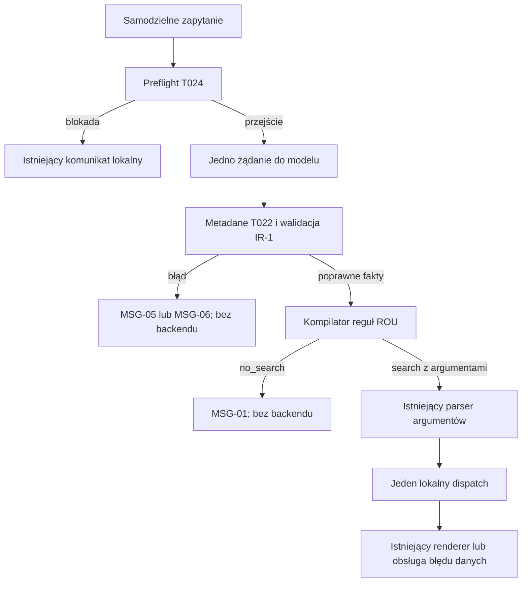

# IR-1 — kontrakt interpretacji zapytania

Data: 2026-11-18. **Wybrany projekt T025, niewdrożony (DEC-15).**
Wymagania: [spec.md](spec.md). Wdrożenie: T026 w [tasks.md](tasks.md).
Weryfikacja projektu: [verification.md](verification.md#t025--projekt-ir-1-zakończony).

## 1. Decyzja i granice

Wybrano **jedno wymuszone narzędzie `submit_recipe_interpretation`**, które
przekazuje rozpoznane fakty. Narzędzie nie wyszukuje i nie ma dostępu do
katalogu. Aplikacja waliduje fakty, stosuje reguły i dopiero wtedy decyduje
o jednym lokalnym wywołaniu istniejącego backendu. Model nie wypełnia
wartości domyślnych ani nie redaguje końcowej odpowiedzi.

To zastąpienie warstwy interpretacji, bez nowej funkcji użytkowej, diety,
filtra, wielu celów, pamięci lub dodatkowego modelu. Pozostają Winiary,
gpt-4o-mini i istniejące reguły ROU/NTO/INT/ERR. Aktywny kod nadal używa V0.
T025 nie zawiera adaptera, kompilatora, promptu IR ani płatnego pomiaru.

| Rozważany wariant | Decyzja |
| --- | --- |
| Kolejne przykłady przy auto + bezpośrednie get_recommendations | Nie wybrano: model nadal jednocześnie ustala reguły domyślne i wybiera kanał; T023 pokazało regresje innych pól. |
| Wymuszone get_recommendations dla każdego zapytania | Nie wybrano: myli obowiązek interpretacji z obowiązkiem wyszukania; usuwa poprawne decyzje no_tool. |
| Ścisły JSON w content | Możliwy technicznie, lecz nie wybrano: wymaga nowej ścieżki konsumpcji content. Wybrany wariant zachowuje zasadę, że zwykły tekst nie uruchamia backendu. |
| Wymuszona, ścisła interpretacja faktów i lokalny kompilator | **Wybrano:** jeden model i jeden format, bez wymuszania wyszukiwania; reguły wynikające z faktów są sprawdzalne bez LLM. |

OpenAI Docs opisuje wymuszenie konkretnej funkcji i strict mode. Obiekty
muszą mieć additionalProperties=false i wszystkie pola wymagane. To
gwarancja kształtu kompletnej odpowiedzi bez odmowy dostawcy, nie trafności
rozumienia. [Function calling](https://developers.openai.com/api/docs/guides/function-calling),
[Structured Outputs](https://developers.openai.com/api/docs/guides/structured-outputs).
[Karta gpt-4o-mini](https://developers.openai.com/api/docs/models/gpt-4o-mini)
potwierdza obsługę obu mechanizmów i oznacza model jako deprecated;
sprawdzono 2026-11-18. Nie zmieniono modelu ani nie sprawdzano konta przez API.

## 2. Przepływ i odpowiedzialność



| Warstwa | Odpowiedzialność |
| --- | --- |
| Model | Czy jest samodzielna prośba o posiłek; jakie wymagania, dopuszczenia i cofnięcia wymagań występują w tekście; fragment tekstu dla każdego faktu. |
| Walidator IR | Metadane, dokładnie jeden właściwy call, JSON bez duplikatów kluczy, wersja, typy, słowniki, źródła i lokalne inwarianty. Nie zgaduje brakujących faktów. |
| Kompilator | Znaczenie faktów według reguł poniżej, konflikty, brak zgodnej reprezentacji, wartości domyślne i siedem dotychczasowych parametrów. Nie czyta swobodnego tekstu modelu. |
| Backend i renderer | Dotychczasowa selekcja, integralność, SKU, liczby i prezentacja; bez zmian kontraktu. |

Po bloku preflight: najwyżej jedno żądanie SDK, brak retry i drugiego modelu
do korekty lub redakcji. `submit_recipe_interpretation` nie powoduje drugiego
żądania do OpenAI z wynikiem backendu. Odpowiedź końcową tworzy aplikacja.

## 3. Transport i schemat

Jedynym narzędziem widocznym dla modelu w trybie IR-1 jest
`submit_recipe_interpretation`, ze strict=true i
[tym schematem parametrów](contracts/interpretation-v1.schema.json).
Dla Chat Completions wybór funkcji ma postać:

```json
{"type":"function","function":{"name":"submit_recipe_interpretation"}}
```

`parallel_tool_calls=false`; model=gpt-4o-mini, temperatura=0,1,
max_completion_tokens=1024, timeout=30 s, max_retries=0,
endpoint=https://api.openai.com/v1. Limit 1024 dotyczy przyszłego adaptera:
nie przenosi zatwierdzonych budżetów dawnych kampanii. Nie ucinać faktów,
żeby zmieścić się w limicie; length kończy zapytanie błędem T022.

Schemat to obiekt z trzema wymaganymi polami, bez dodatkowych kluczy:

| Pole | Znaczenie |
| --- | --- |
| contract_version | Stałe IR-1. Nie odczytywać innej wersji jako tej samej struktury. |
| request_kind | recipe, other albo context_dependent. To klasyfikacja modelu, nie pozwolenie na dispatch. |
| facts | Lista jawnych faktów; [] jest dozwolone, np. dla „Podaj przepis”. |

Każdy fakt ma wymagane kind, value, status i source. Alternatywy anyOf
znajdują się wewnątrz listy, nie na korzeniu schematu. Słowniki i typy
w pliku schematu są wspólnym źródłem dla przyszłego requestu i walidatora.
Nie dodajemy drugiego, niezależnego zestawu enumów. Specyfikacja schematu
musi być dostępna w lokalnym checkoutcie; T026 sprawdzi także jej brak.

| kind | value | status |
| --- | --- | --- |
| diet | vegetarian, vegan, pescetarian | required, waived |
| exclusion | meat, fish, gluten, lactose | required, waived |
| protein | meat, fish | required, permitted, waived |
| nutrition_goal | low_kcal, high_protein, keto | required, waived |
| category | sześć istniejących kategorii backendu | required, waived |
| time_limit | dodatnia liczba całkowita minut | required, waived |
| quick | quick | required, waived |
| result_count | dodatnia liczba całkowita | required, waived |
| unsupported | allergy, exclusion, constraint, ambiguity | required, waived |

Nie ma faktu none, standard ani domyślnej liczby propozycji. Nieobecny
wymóg oznacza brak faktu tego rodzaju. Przepisanie wartości domyślnej jako
faktu bez wskazania użytkownika jest błędem ekstrakcji.
`permitted` nie oznacza obowiązku obecności. `waived` znosi obowiązek,
nie zakazuje składnika. „Nie chcę ryby” jest wykluczeniem fish, a nie
protein/waived; „nie musi być z rybą” jest protein/waived.

`source` musi być niepustym, niebiałym, dosłownym fragmentem bieżącego user_message,
z zachowaniem wielkości liter, znaków i odstępów. Nie stosować normalizacji
lub substringu z promptu systemowego. Fragment powinien zawierać operator,
np. „ryby mogą być”, a nie samo „ryby”. Powtarzające się i nakładające
fragmenty są dozwolone. Nie używamy liczonych przez model indeksów znaków.
Źródła służą kontroli pochodzenia i diagnozie; nie są uzasadnieniem do UI.

Lokalnie odrzucić m.in. 0, wartości ujemne, true, 1.0 i "30" w polu
liczbowym, puste/nieobecne źródło oraz źródło spoza user_message. Sam
JSON Schema nie sprawdza powiązania tekstu i znaczenia faktu. Nie przyjmować
nieznanego kind/value, nie usuwać błędnego faktu i nie zastępować go defaultem.

## 4. Reguły kompilatora

Kompilator jest czystą funkcją zweryfikowanej interpretacji. Zwraca jeden
z wyników: search z argumentami, no_search bez argumentów albo kontrolowany
błąd kontraktu. Nie ma dostępu do SDK, katalogu, historii i expected z evals.

1. Najpierw walidować **wszystkie** fakty. Dopiero potem usuwać powtórzenia
   tego samego kind/value/status. Różne poprawne source nie zmieniają
   znaczenia. Nie deduplikować kosztem ukrycia błędnego źródła.
2. unsupported/allergy zatrzymuje także przy waived, zgodnie z konserwatywną
   polityką wzmianek alergii. Inne unsupported/required daje no_search;
   unsupported/waived samo nie blokuje ani nie dodaje filtra.
3. request_kind other/context_dependent daje no_search. Brak kategorii
   przy recipe nie oznacza braku kontekstu. Nie stosować defaultów po
   błędzie walidacji ani w celu zamiany other na recipe.
4. Fakty waived nie tworzą dodatnich wymagań. Ten sam kind/value opisany
   równocześnie jako required i waived jest niejednoznaczny: no_search,
   bez reguły „ostatni wygrywa”. Required i permitted dla tego samego protein
   są zgodne; obowiązek required pozostaje. Jawna dieta i waived wykluczenie
   mięsa to różne fakty — dieta pozostaje.
5. Dwa różne aktywne diet, category, nutrition_goal, result_count albo
   time_limit nie są automatycznie łączone: no_search. To nie wprowadza
   obsługi wielu wartości. Równe wartości są deduplikowane. Alternatywy
   „X lub Y” bez jednej reprezentacji są unsupported/ambiguity. Nie wybierać
   pierwszej wartości. T020 nadal dotyczy odrębnego projektu wielu celów.
6. Przed ustaleniem diety rozpatrzyć dodatnie exclusion meat/fish i required
   protein. Meat wymagane i wykluczone lub fish wymagane i wykluczone daje
   no_search. Samotne dodatnie exclusion fish bez dodatniego exclusion meat
   pozostaje nieobsługiwane, zgodnie z obecną granicą samodzielnego fish_free;
   nie usuwać go nawet przy jawnej diecie.
7. Jedna jawna dieta required ma pierwszeństwo i nie jest osłabiana przez
   permitted fish/meat. Pescetarian z wymaganym wykluczeniem fish daje
   no_search także przy wykluczeniu meat: sam pescetarian nie przenosi
   zakazu ryb, a nie zmieniamy jawnej diety na vegetarian. Jeśli jawnej
   diety nie podano: exclusion meat+fish daje
   vegetarian; samo meat z required/permitted fish daje pescetarian;
   samo meat bez tego doprecyzowania daje vegetarian. W pozostałych
   przypadkach diet=none. Nie wyprowadzać pescetarian z samej ryby.
8. Tylko required protein ustawia fish/meat. Bez niego protein_preference=none.
   Dwa różne required protein są nieobsługiwane. High_protein, permitted
   fish i pescetarian nie tworzą wymogu ryby. Sprawdzić zgodność diety:
   vegetarian/vegan z wymaganym fish/meat lub pescetarian z meat daje
   no_search, bez usuwania części prośby i bez zamienników.
9. Required exclusion gluten/lactose mapuje na gluten_free/lactose_free,
   bez powtórzeń, w tej kolejności. Vegan nie dodaje lactose_free. Bez
   tych wymagań restrictions=[]. Nie kodować bez mleka jako lactose_free.
10. Jedna aktywna kategoria i cel są przepisywane bez zamiany lunch→obiad.
    Przy ich braku: category=kolacja i nutrition_goal=standard. Brak
    result_count daje top_n=3; dodatnia liczba powyżej 3 pozostaje obsługiwana.
11. Jeden required time_limit ma pierwszeństwo przed quick/required.
    Bez jawnego limitu quick/required daje 30 minut. Bez obu pominąć
    time_max; nie dodawać null do argumentów backendu. Quick nie dodaje
    low_kcal, a low_kcal nie dodaje czasu.
12. Dla search przekazać komplet sześciu wymaganych pól i opcjonalne time_max
    przez istniejący parse_recipe_tool_arguments. Dopiero poprawny rezultat
    umożliwia jeden run_recommendation_tool. Błędnego wyniku kompilatora nie
    poprawiać kolejnymi defaultami. Nieoczekiwane błędy programistyczne nadal
    podlegają ERR-03, a błędy danych po dispatch INT/ERR, bez częściowego sukcesu.

**Ograniczenie:** [] dla „Podaj przepis” i błędne [] dla „deser bez mięsa”
są strukturalnie takie same. Program nie potrafi dla dowolnej wypowiedzi
udowodnić kompletności faktów. Nie dodajemy ukrytej listy słów naprawiającej
pominięcia. Ocenimy ekstrakcję oddzielnie, a jej błędy pozostają porażkami
całego zapytania. Poprawny source też nie dowodzi poprawnej etykiety.

## 5. Przykłady i scenariusze akceptacji

[Przykłady maszynowe](contracts/interpretation-v1.examples.json) są ręcznymi
fixture'ami projektu, nie odpowiedziami modelu i nie holdoutem. Dwanaście
wybranych zapytań oraz ich expected backendu pochodzi bez zmian z T023.
Nowe adnotacje faktów wymagają przeglądu przed przyszłym pomiarem. Akceptuje
się różne poprawne source; ocena faktów porównuje kind/value/status,
a dosłowność źródła jest osobną kontrolą. Alternatywne równoważne zestawy
faktów muszą zostać opisane przed pomiarem, nigdy po obejrzeniu odpowiedzi.

| ID scenariusza | Warunek akceptacji w T026 |
| --- | --- |
| IRC-01 | recipe i [] dla „Podaj przepis”: sześć domyślnych pól, bez time_max, jeden dispatch. |
| IRC-02 | „obiad z dużą ilością białka”: high_protein bez wymyślonego protein; rzeczywisty call interpretacyjny, bez wykonania content. |
| IRC-03 | „deser bez mięsa”: exclusion meat daje vegetarian niezależnie od deseru. |
| IRC-04 | „coś na szybko, wegańskie”: vegan, domyślna kolacja, 30 minut. |
| IRC-05 | „4 pomysły na kolację pescetariańską”: pescetarian, none, top_n=4. |
| IRC-06 | Bez mięsa z permitted fish / required fish / waived fish: odpowiednio pescetarian-none / pescetarian-fish / vegetarian-none. |
| IRC-07 | Jawne vegetarian i permitted fish pozostaje vegetarian; required fish jest konfliktem bez dispatch. |
| IRC-08 | Fit/lekka z dietą, glutenem i czasem zachowuje low_kcal; jawne 50 minut wygrywa z quick. |
| IRC-09 | Samotne wykluczenie fish nie staje się protein=none; para meat+fish ma reprezentację vegetarian. |
| IRC-10 | Waived wykluczenie nie tworzy diety ani nie usuwa jawnego vegan. |
| IRC-11 | Dwie restrykcje łączą się, vegan nie tworzy dodatkowej restrykcji. |
| IRC-12 | Dwa aktywne cele/kategorie/liczby lub sprzeczne required/waived: no_search, bez wyboru pierwszego/ostatniego. |
| IRC-13 | Other/context_dependent/unsupported bez dispatch; brak kategorii przy recipe sam nie daje context_dependent. |
| IRC-14 | Puste/obce źródło, float/string/bool zamiast integer, obcy enum/wersja/pole lub duplikat klucza JSON: błąd, bez defaultów. |
| IRC-15 | Brak calla, call legacy get_recommendations lub wiele calls w trybie IR: błąd protokołu, bez fallbacku z content. |
| IRC-16 | API error, empty choices, length, content_filter i refusal: dotychczasowe kontrolowane błędy T022 przed dispatch. |
| IRC-17 | Preflight T024 ma pierwszeństwo, 0 SDK/backendu przy blokadzie; pięć odblokowanych przypadków nadal dociera do adaptera. |
| IRC-18 | Pusty wynik, błąd danych lub renderera po dispatch zachowuje MSG-04/07/08; nie dodaje drugiego LLM. |
| IRC-19 | Taki sam request i kontrolowana odpowiedź: jedno SDK, jedno przekazanie interpretacji, maksymalnie jeden backend; liczniki rozdzielone. |
| IRC-20 | Historyczne źródła/etykiety/raporty oraz domyślny tryb legacy z V0 pozostają bez zmian. |

## 6. Migracja ROU/NTO i komunikatów

Obecne ROU/NTO pozostają kontraktem aktywnego legacy. T025 zatwierdza
projekt **wersjonowanej migracji w przyszłym trybie IR-1**, bez cichej zmiany
znaczenia historycznych tool_calls. Nie zmieniamy RECIPE_TOOLS ani parsera
backendu, żeby przyjmowały nowy pakiet.

| Dotychczasowe ustalenie | IR-1 po wdrożeniu i kwalifikacji |
| --- | --- |
| ROU: model wybiera get_recommendations lub brak calla | Model przekazuje jeden submit_recipe_interpretation; aplikacja wybiera search/no_search po kompilacji. Reguły znaczenia i expected końcowego zachowania pozostają. |
| NTO-01: biznesowe no_tool | Nadal brak wyszukania dla poza zakresem, sprzeczności i braku samodzielnej prośby. Technicznie może istnieć jeden call interpretacyjny. |
| NTO-02/08 i DEC-10: brak calla jest no_tool, bez action/reason | W legacy bez zmian. W IR-1 brak calla jest błędem protokołu; no_tool biznesowe oznacza no_search/0 dispatch. Nowe request_kind i facts są wewnętrzne; nie dodajemy tekstowej przyczyny do UI. |
| NTO-03/04 | MSG-01 dla poprawnie odczytanego no_search, także błędnego biznesowo w eval. Nie tłumaczymy użytkownikowi decyzji na podstawie modelowego źródła czy kodu unsupported. Content nadal ignorowany. |
| NTC-08: JSON wyłącznie w content → MSG-01 | Legacy pozostaje. IR-1: brak wymaganego calla → MSG-06; nie wykonujemy tego JSON-a. |
| NTO-05/06 | MSG-05 dla błędu SDK; MSG-06 dla metadanych/protokołu/IR; MSG-04/07/08 dopiero po istniejącym dispatch. |
| NTO-07 | Nadal ocena względem niezmienionego expected tool/no_tool. Błąd transportu nie jest sukcesem odmowy. Wypełnienie wymuszonej funkcji nie jest sukcesem decyzji. |

Wynik adaptera do aplikacji ma kontrakt search(args) / no_search / error.
Przy no_search i error args nie istnieją. Renderer, komunikaty i payload
rekomendacji pozostają bez zmian. W runtime nie ma dostępu do etykiet eval.

## 7. Diagnostyka

Zachować response_validation_version=T022-v1 i dodać
interpretation_contract_version=IR-1. Rozdzielić:

- api_calls — rzeczywiste próby SDK;
- interpretation_tool_calls — zgłoszenia submit_recipe_interpretation;
- backend_calls — wyłącznie run_recommendation_tool;
- request_kind, validation_status, compiler_action i effective_action.

effective_action nadal ma wartości tool/no_tool/error: search mapuje na tool,
no_search na no_tool, błąd pozostaje error. Nie liczyć wymuszonego calla jako
model_decision_correct=true. Historyczne model_action ma znaczenie legacy;
w IR jest nieadekwatne, a ocena request_kind wymaga osobnej etykiety rodzaju.

Etapy: preflight, api, protocol, interpretation, decision, semantics,
dispatch/render. Nie mieszać złego enumu/źródła z błędną interpretacją,
która jest formalnie poprawna. Pola końcowe oceniać tylko przy poprawnym
search i expected=tool. Fakty oceniać osobno, tylko dla adnotowanych przypadków.
Przy no_search dla expected=tool nie dopisywać brakujących parametrów.

Logi pomiaru mogą zawierać kontrolowane zapytania, fakty i source. Nie
włączać kluczy, danych katalogu lub rzeczywistych rozmów do payloadów
eksperymentu. Niezgodny model, błędy techniczne i niekompletność są jawne.

## 8. Wdrożenie i weryfikacja

**T026 — implementacja offline.** Czyste moduły kontraktu/walidacji,
kompilatora i adaptera; istniejący kod rekomendacji i schema backendu bez
zmian. Wewnętrzny przełącznik legacy/facts_v1 ma domyślnie legacy/V0.
Wszystkie IRC-01–20, pełna regresja bez pominięć, klient podstawiony,
SDK i zapisy katalogu zablokowane. Nowego trybu nie włączać na podstawie
samych fixture'ów. Nowe instrukcje IR powstaną i zostaną zamrożone w T026;
T025 nie pisze kolejnego promptu V6.

**H-IR1:** na jawnych trudnych zapytaniach zastąpienie całej warstwy
bezpośrednich argumentów przez IR-1 poprawi poprawność decyzji i końcowych
parametrów bez regresji per-case i błędnego dispatch. To hipoteza o całej
warstwie, nie dowód osobnego wpływu strict lub kompilatora.

**T027 — przygotowanie i mały pomiar, dopiero po T026.** Kontrola A:
świeże legacy z V4. Kandydat B: IR-1. Jedynym czynnikiem systemowym jest
wersja warstwy interpretacji; wspólne model, temperatura, limit 1024,
preflight T024, backend, renderer i expected. Prompt i wire schema są
częścią tej wymienianej warstwy. Nie udawać izolowania pojedynczego zdania
promptu; taki wniosek wymagałby odrębnej ablacji.

Pierwszy diagnostyczny podzbiór: intent_003/004/015/025/032,
v5_diag_004/008/009/010 i routing_005/006 oraz v5_diag_012 — dokładne
istniejące zapytania i expected. Dziewięć tool, trzy no_tool. Trzy rundy
A/B, B/A, A/B: **72 zaplanowane wywołania SDK**, bez podwajania raw/application.
Raw interpretacja odbywa się bez katalogu. Tę samą odpowiedź oceniamy jako
transport, fakty i wynik lokalnego kompilatora; deterministyczny preflight
ma osobny audyt/replay bez dodatkowego LLM. To nie nowe dwa niezależne
pomiary modelu. Query blokowane w rzeczywistej aplikacji może mieć żądanie
tylko w jawnie zatwierdzonym diagnostycznym raw.

**IR1-D1 — reguła diagnostyczna ustalona przed pomiarem:**

1. Komplet 72 obserwacji, jeden resolved model i 0 błędów API/metadanych.
   Pierwsza awaria przerywa pomiar; bez SDK retry i selektywnego wznowienia.
2. B ma wszystkie 9/9 no_tool, co najmniej 25/27 poprawnych tool,
   co najmniej 11/12 przypadków stabilnych 3/3, zero błędów protokołu/
   walidacji IR i zero błędnych dispatch.
3. Intent_003/004/032 i v5_diag_004 w B muszą mieć 3/3.
4. Żadne z 12 ID nie pogarsza się względem świeżego A; liczba poprawnych
   dodatnich prób B jest większa niż A. Remis nie dowodzi poprawy.
5. Raport podaje błędy kanału, decyzji i parametrów oddzielnie oraz błędy
   ekstrakcji B, conditional field accuracy i wszystkie porażki. Nie zmienia
   expected ani reguły po wynikach. Brak kompletnych adnotacji faktów nie
   jest dowodem ich poprawności.

Zwykłe błędy decyzji, argumentów, protokołu lub walidacji IR są ocenami
niepoprawnymi i nie uruchamiają ponowienia. Nie zatrzymują same w sobie
zbierania pozostałych ocen. Zatrzymanie po awarii dotyczy SDK i sygnałów
metadanych T022 (m.in. length/refusal), niezależnie od ramienia.

Przed SDK T027 wymaga zamrożonych pełnych payloadów, schematów, źródeł,
etykiet i runtime, sprawdzenia dostępności modelu i cennika, rzeczywistego
kosztorysu dla nowych payloadów oraz osobnej zgody na zakres i próg rezerwy.
T025 nie szacuje kosztu z dawnych tokenów i nie uruchamia tego planu.

72 wywołania są diagnostyką, **nie bramką wdrożenia**. Ewentualna kwalifikacja
przed włączeniem trybu wymaga pełnego zbioru rozwojowego, przeglądu nowych
etykiet, niezależnego holdoutu i ACC w T010/T013 oraz świeżego porównania
z aktywnym V0. V4 jest kontrolą diagnostyczną, nie wdrożonym baseline.
Nie wznawiać T009 ani T012. Negatywny wynik T027 kończy eksperyment
udokumentowaną decyzją; nie uruchamia automatycznie kolejnego wariantu.

## 9. Co projekt gwarantuje, a czego nie dowodzi

Reguły domyślne i zgodność poprawnie rozpoznanych faktów można sprawdzić
lokalnie. Brak rozróżnienia tekst/call jest błędem protokołu zamiast
niejednoznacznego no_tool. Nadal możliwe są pominięte lub błędnie nazwane
fakty, zła klasyfikacja recipe/other, źródło o złym znaczeniu i odrzucenie
poprawnego tekstu przez zbyt ścisłe cytowanie. Dłuższe argumenty mogą
zwiększyć tokeny i opóźnienie; limit oraz koszt wymagają nowego planu.
Obecny preflight pozostaje ograniczoną gramatyką T024, nie ogólnym NLP.

T025 zamyka wybór projektu i kontraktu. Nie jest dowodem poprawy modelu,
gotowości MVP lub wdrożenia. Bieżący pełny wynik kodu to 314/314 z T024;
w T025 kontrolujemy artefakty projektu, bez udawania nowej regresji aplikacji.
